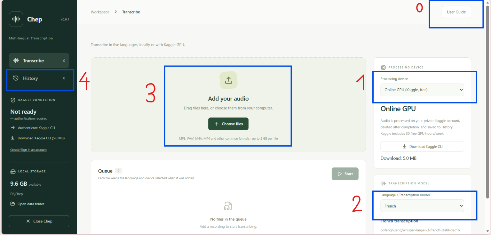

# Chep

Multilingual transcription for Windows.

## About This Project

Chep is a desktop application for AI-assisted transcription from audio and video. This personal AI engineering project explores how model selection, precision, chunk length and concurrent inference affect transcription quality, speed and memory use—and makes those decisions accessible through a simple interface.

The work progressed from French Whisper experiments to distilled models running through **faster-whisper and CTranslate2**, a high-performance inference engine for converted models. Chep evaluates and deploys upstream models; it does not train them. Its React interface opens in your browser while a Python backend runs locally.

## Key Features

- **Five languages:** French, English, Spanish, German and Vietnamese, each with a pinned model and its own execution policy.
- **Your choice of compute:** local NVIDIA CUDA GPU, CPU, or your own Kaggle GPU account. No Chep subscription or paid inference API; Kaggle quotas and availability apply.
- **Local privacy:** local modes keep recordings and transcripts on your computer and work offline after asset setup. Online mode uploads audio to private Kaggle resources and attempts cleanup after verified results return.
- **Measured execution profiles:** precision and concurrent chunk workers selected from benchmark evidence, with local compatibility probes and CPU fallback.
- **Persistent workflow:** sequential file queue, per-file cancellation, interruption/retry, History and TXT/SRT export.

## Installation & Getting Started

### For Users (Windows Installer)

Requires **Windows 10 or later, x64**. Python, Conda and Docker are not required.

1. Obtain `Chep-Setup-0.6.2-win-x64.exe` from the maintainer. The local build is in `release/`; a public download URL has not yet been established.
2. Run Setup and choose application and data folders. Optional component selections are downloaded by the app after installation.
3. Open **Chep** and start using.

### For Developers (Build from Source)

Use Windows x64, Python 3.12 and Node.js/npm compatible with Vite 6 (Node 24.20.0 was available for this audit). From the source folder:

```powershell
py -3.12 -m venv .venv
.\.venv\Scripts\python.exe -m pip install -r requirements-lock.txt
npm.cmd ci
npm.cmd run build
.\.venv\Scripts\python.exe launch.py
```

For tests, install `requirements-dev.txt` and run `python -m pytest -q` using that environment. To package an `.exe`, install Inno Setup 6 and use its actual compiler path:

```powershell
.\.venv\Scripts\python.exe scripts/build_windows.py --iscc 'C:\Program Files (x86)\Inno Setup 6\ISCC.exe'
```

Output: `release/Chep-Setup-0.6.2-win-x64.exe`.

## Usage

**Step 0:** Read the **User Guide** in the app.

1. **Select a processing device:** Online GPU (Kaggle), Local GPU (CUDA), or CPU only.
2. **Choose the transcription language/model.**
3. **Add files and click Start:** files process sequentially; remove pending items or cancel the active task as needed.
4. **Open History:** view completed transcripts and download TXT or SRT.

**Device and model choices are captured when each file is added.** To change an existing queued file's choices, remove and re-add that file.



## Performance & Benchmarks

### Multilingual model evaluation

These are **ten-sample FLEURS test pilots per language**, not full-dataset scores. Each locale's first ten recordings was concatenated with 0.5-second separators. WER/CER use dataset references and Whisper text normalization. GPU profiles ran on one Tesla T4, with one warmup and three measured repetitions; concurrency means chunk workers, not batch size.

| Language | Model | FLEURS test locale | WER ↓ | CER ↓ | T4 profile / chunk |
| --- | --- | --- | ---: | ---: | --- |
| French | [French distil-dec16](https://huggingface.co/bofenghuang/whisper-large-v3-french-distil-dec16) | fr_fr | 11.73% | 4.29% | FP16 × 2 / 40 s |
| English | [Distil-Large-v3.5](https://huggingface.co/distil-whisper/distil-large-v3.5-ct2) | en_us | 7.26% | 2.66% | INT8/FP16 × 2 / 30 s |
| Spanish | [Whisper Large-v3 Turbo ES](https://huggingface.co/adriszmar/whisper-large-v3-turbo-es) | es_419 | 3.25% | 1.21% | INT8/FP16 × 2 / 30 s |
| German | [Whisper Large-v3 Turbo German](https://huggingface.co/primeline/whisper-large-v3-turbo-german) | de_de | 3.85% | 0.86% | INT8/FP16 × 2 / 30 s |
| Vietnamese | [PhoWhisper-medium](https://huggingface.co/vinai/PhoWhisper-medium) | vi_vn | 9.33% | 6.44% | FP16 × 2 / 30 s |

Different language subsets are not a model ranking. French preserves an explicitly selected FP16 policy; other profiles pass quality, speed and memory gates.

### French optimization evolution

Available long-form CT2 measurements use the same nine private recordings totaling 45,608.52 seconds on a T4:

| Pipeline | Backend | Input chunk | Parallel chunks | Workers | Inference | Peak VRAM | Quality evidence |
| --- | --- | --- | ---: | ---: | ---: | ---: | --- |
| Full French model, baseline | PyTorch | 120 s | 4 | — | 8,591.22 s | 10,100 MiB | - |
| Distil-dec16, baseline | PyTorch | 120 s | 4 | — | 5,570.73 s (35.2% faster) | 6,085 MiB (39.8% lower) | 10.93% relative WER |
| Distil-dec16, long chunks | CTranslate2 | 120 s | — | 1 | 2,281.86 s (73.4% faster) | 3,639 MiB (64.0% lower) | 48.23% relative WER |
| Distil-dec16, shorter concurrent chunks | CTranslate2 | 40 s | — | 2 | 2,644.62 s (69.2% faster) | 3,807 MiB (62.3% lower) | 12.91% relative WER |

**The fastest configuration was not the preferred one:** the 120-second CT2 pipeline showed substantially higher disagreement with the full PyTorch baseline (48.23% relative WER). The selected 40-second, two-worker configuration achieved **69.2% faster inference and 62.3% lower peak VRAM**, with 12.91% relative WER. Increasing concurrency from two to four workers improved speed by only 0.19% while consuming more VRAM. Relative WER does not represent accuracy against human-verified ground truth, and timing variability was not measured.

Quantization also needs quality checks: Vietnamese INT8 reached 18.00% WER versus 9.33% FP16 on its pilot, so that quantized profile is excluded.

## Acknowledgements

Model authors and maintainers: [Bofeng Huang](https://huggingface.co/bofenghuang/whisper-large-v3-french-distil-dec16), [Distil-Whisper](https://huggingface.co/distil-whisper/distil-large-v3.5-ct2), [adriszmar](https://huggingface.co/adriszmar/whisper-large-v3-turbo-es), [primeLine](https://huggingface.co/primeline/whisper-large-v3-turbo-german), and [VinAI](https://huggingface.co/vinai/PhoWhisper-medium). Thanks also to [ostwilkens](https://huggingface.co/ostwilkens/whisper-large-v3-turbo-german-ct2) for the German CT2 conversion. Chep's `nunu-willump` repositories preserve or convert these assets; they are not the original model authors.

Built on [OpenAI Whisper](https://github.com/openai/whisper), [faster-whisper](https://github.com/SYSTRAN/faster-whisper), [CTranslate2](https://github.com/OpenNMT/CTranslate2), [Hugging Face](https://huggingface.co/) and [Kaggle](https://www.kaggle.com/), with evaluation data from [FLEURS](https://huggingface.co/datasets/google/fleurs).
