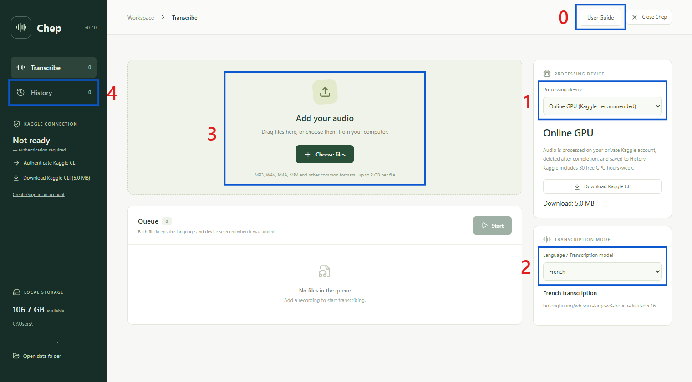

# Chep

[](./LICENSE)

Multilingual transcription for Windows. A web version is also available at [chep-transcript.vercel.app](https://chep-transcript.vercel.app/) (Google Colab is not supported in the web version).

## About This Project

Chep is a desktop application for AI-assisted transcription from audio and video. This personal AI engineering project explores how model selection, precision, chunk length and concurrent inference affect transcription quality, speed and memory use—and makes those decisions accessible through a simple interface.

The work progressed from French Whisper experiments to distilled models running through **faster-whisper and CTranslate2**, a high-performance inference engine for converted models. Chep evaluates and deploys upstream models; it does not train them. Its React interface opens in your browser while a Python backend runs locally.

## Key Features

- **Four languages:** French, English, Spanish and Vietnamese, each with a pinned model and its own execution policy.
- **Your choice of compute:** local NVIDIA CUDA GPU, CPU, or your own Kaggle GPU account. No Chep subscription or paid inference API; Kaggle quotas and availability apply.
- **Local privacy:** local modes keep recordings and transcripts on your computer and work offline after asset setup. Online mode uploads audio to private Kaggle resources and attempts cleanup after verified results return.
- **Kaggle model attachment:** online notebooks attach versioned public model Datasets owned by the [Chep-Transcript](https://www.kaggle.com/organizations/french-transcript/) Kaggle organization (`french-transcript`); each signed-in user's recording remains in a private Dataset under that user's own account. For audio shorter than 21 minutes Chep uses one notebook; from 21 minutes it uses two notebooks with 5 seconds of shared audio and a conservative seam merge. Actual GPU access still depends on the user's Kaggle account and quota.
- **Measured execution profiles:** precision and concurrent chunk workers selected from benchmark evidence, with local compatibility probes and CPU fallback.
- **Persistent workflow:** sequential file queue, per-file cancellation, interruption/retry, History and TXT/SRT export.

## Installation & Getting Started

### For Users (Windows Installer)

Requires **Windows 10 or later, x64**. Python, Conda and Docker are not required.

1. Obtain `Chep-Setup-0.7.0-win-x64.exe` from the maintainer. The local build is in `release/`; a public download URL has not yet been established.
2. Run Setup and choose application and data folders. Optional component selections are downloaded by the app after installation.
3. Open **Chep** and start using.

### For Developers (Build from Source)

Use Windows x64, Python 3.12 and Node.js/npm compatible with Vite 6 (Node 24.20.0 was available for this audit). From the source folder:

```powershell
py -3.12 -m venv .venv
.\.venv\Scripts\python.exe -m pip install -r requirements-lock.txt
npm.cmd ci
npm.cmd run build
.\.venv\Scripts\python.exe launch.py
```

For tests, install `requirements-dev.txt` and run `python -m pytest -q` using that environment. To package an `.exe`, install Inno Setup 6 and use its actual compiler path:

```powershell
.\.venv\Scripts\python.exe scripts/build/build_windows.py --iscc 'C:\Program Files (x86)\Inno Setup 6\ISCC.exe'
```

Output: `release/Chep-Setup-0.7.0-win-x64.exe`.

## Usage

**Step 0:** Read the **User Guide** in the app.

1. **Select a processing device:** Online GPU (Kaggle), Local GPU (CUDA), or CPU only.
2. **Choose the transcription language/model.**
3. **Add files and click Start:** files process sequentially; remove pending items or cancel the active task as needed.
4. **Open History:** view completed transcripts and download TXT or SRT.

**Device and model choices are captured when each file is added.** To change an existing queued file's choices, remove and re-add that file.



## Performance & Benchmarks

All evaluations below ran on **Kaggle Tesla T4 GPUs** (`15,360 MiB`, driver `580.178.04`) against **human-verified reference transcripts** using `faster-whisper 1.2.1` and `ctranslate2 4.8.2`, attaching the pinned version-1 model Datasets from the [Chep-Transcript](https://www.kaggle.com/organizations/french-transcript/) Kaggle organization (`french-transcript/*-whisper-ct2/1`). WER and CER are micro-averaged after Unicode NFC normalization and Whisper `BasicTextNormalizer(remove_diacritics=False)` via `jiwer 3.1.0`. Long-form and talk/session benchmarks execute exact non-overlapping fixed chunks with the deployed worker's concurrency (`worker.py`), following one warmup pass in an isolated child process per candidate.

### Multilingual model evaluation

Full-split evaluation across all **3,088 utterances** of [`google/fleurs`](https://huggingface.co/datasets/google/fleurs) (`test`), paired with public long-form or real-world corpora (`eustlb/french-long-form-test`, `distil-whisper/tedlium-long-form`, `deepdml/mtedx`, and `leduckhai/VietMed`):

| Language | Model | Full FLEURS `test` (N) | FLEURS WER ↓ | FLEURS CER ↓ | Long-form / real-world corpus | Long-form WER ↓ | Long-form CER ↓ | Long-form RTF ↓ | Long-form VRAM | T4 profile / chunk |
| --- | --- | --- | ---: | ---: | --- | ---: | ---: | ---: | ---: | --- |
| French | [French distil-dec16](https://huggingface.co/bofenghuang/whisper-large-v3-french-distil-dec16) | `fr_fr` (676, 1.95 h) | 6.84% | 3.58% | `eustlb/french-long-form-test` (7 native TEDx talks, 2.02 h) | 11.07% | 7.58% | 0.0674 | 3,807 MiB | `float16` × 2 / 40 s |
| English | [Distil-Large-v3.5](https://huggingface.co/distil-whisper/distil-large-v3.5-ct2) | `en_us` (647, 1.77 h) | 7.11% | 3.93% | `distil-whisper/tedlium-long-form` (11 native TED talks, 2.47 h) | 6.20% | 4.80% | 0.0238 | 1,471 MiB | `int8_float16` × 2 / 30 s |
| Spanish | [Whisper Large-v3 Turbo ES](https://huggingface.co/adriszmar/whisper-large-v3-turbo-es) | `es_419` (908, 3.09 h) | 6.39% | 4.11% | `deepdml/mtedx` `es/test` (12 grouped talks / 1,003 segs, 1.94 h) | 12.99% | 9.25% | 0.0277 | 1,599 MiB | `int8_float16` × 2 / 30 s |
| Vietnamese | [PhoWhisper-medium](https://huggingface.co/vinai/PhoWhisper-medium) | `vi_vn` (857, 3.00 h) | 11.94% | 8.39% | `leduckhai/VietMed` `test` (27 grouped sessions / 3,437 segs, 6.50 h) | 13.28% | 9.61% | 0.0667 | 2,911 MiB | `float16` × 2 / 30 s |

Different language datasets have different speakers, acoustics and text conventions and are not a cross-language ranking. Note that `fr` and `en` use native unsegmented full talks, whereas `es` (`mTEDx`) and `vi` (`VietMed`) reconstruct multi-minute sessions chronologically from segmented utterances (reproducible harness in [scripts/benchmarks/full_eval/](scripts/benchmarks/full_eval/)). With Whisper's `EnglishTextNormalizer`, English scores **6.63% WER** on full `en_us` FLEURS and **4.72% WER** on `tedlium-long-form`.

**Quantization verification (`int8_float16` vs `float16`):** Across the full datasets above, the deployed `int8_float16 × 2` policies (`en`, `es`) stay within **+0.02 to +0.70 pp** WER of `float16 × 2` while reducing peak VRAM by **~960–1,060 MiB** (full FLEURS deltas: EN `+0.05 pp`, ES `+0.12 pp`; long-form deltas: EN `+0.02 pp`, ES `+0.70 pp`). Re-evaluating Vietnamese with `int8_float16 × 2` at full scale yielded `11.96%` vs `11.94%` WER on FLEURS (+0.02 pp) and `13.13%` vs `13.28%` on VietMed (the earlier Oct 2026 pilot's 18.00% figure came from pure `int8` on a 6-sample subset); in `config/transcription_models.json`, French and Vietnamese retain explicit **`float16 × 2`** policies (French `int8_float16 × 2` also measured within `0.05 pp`).

### French optimization evolution

All five optimization stages below were re-evaluated end-to-end on the **same public human-ground-truth French long-form corpus** ([`eustlb/french-long-form-test`](https://huggingface.co/datasets/eustlb/french-long-form-test): 7 complete continuous TEDx talks totaling **7,290.0 s / 121.50 min** and **24,313 normalized reference words**) on Kaggle Tesla T4 GPUs, replacing earlier unverified PyTorch-relative comparisons:

| Pipeline | Backend | Input chunk | Parallel / Workers | Inference ↓ | Peak VRAM ↓ | Ground-truth WER ↓ | Ground-truth CER ↓ |
| --- | --- | --- | ---: | ---: | ---: | ---: | ---: |
| Full French model (`whisper-large-v3-french`), baseline | PyTorch FP16 | 120 s | Batch 4 | 2,172.59 s | 10,005 MiB | 9.56% | 6.70% |
| Distil-dec16, baseline | PyTorch FP16 | 120 s | Batch 4 | 1,131.21 s (47.9% faster) | 6,101 MiB (39.0% lower) | 8.88% | 6.13% |
| Distil-dec16, long chunks | CTranslate2 FP16 | 120 s | 1 worker | 435.07 s (80.0% faster) | 3,607 MiB (63.9% lower) | 44.27% | 38.63% |
| Distil-dec16, shorter concurrent chunks *(deployed single-T4)* | CTranslate2 FP16 | 40 s | 2 workers | 491.36 s (77.4% faster) | 3,807 MiB (61.9% lower) | 11.07% | 7.58% |
| Distil-dec16, split across 2 T4 Notebooks *(5 s overlap + merge)* | CTranslate2 FP16 | 40 s | 2 workers / GPU | 249.16 s max shard (88.5% faster; 264.22 s UTC span) | 3,839 MiB max (3,839 / 3,359 MiB) | 11.42% | 7.99% |

**Key findings from human ground-truth evaluation:**
- **Why Distil-dec16 PyTorch beat Full PyTorch:** Dropping to the 16-layer distilled decoder cut T4 inference time by **47.9%** and peak VRAM by **39.0%**, while improving WER from `9.56%` to `8.88%` (lower deletion and hallucination rates).
- **Why 120-second CTranslate2 chunks failed despite top speed:** Although `120 s / 1 worker` was fastest on one GPU (`435.07 s`), WER degraded to **44.27%** because word deletion rate surged from `1.10%` to **31.70%** when long windows triggered segment truncation inside `faster-whisper`. Switching to non-overlapping **40-second chunks with 2 workers** eliminated that failure mode (word deletion rate **1.28%**, **11.07% WER / 7.58% CER**) while keeping **77.4% faster inference than Step 1** (`2.30×` faster than Step 2) and **61.9% lower peak VRAM** (`3,807 MiB`).
- **Concurrency diminishing returns:** On the same 7,290.0 s corpus at 40 s (`float16`), `2 workers` improved over `1 worker` by **8.4%** (`491.36 s` vs `536.19 s`; `3,807` vs `3,543 MiB`, `11.07%` vs `11.05%` WER), while `4 workers` added only **0.39%** speed (`489.44 s`) for `+624 MiB` extra VRAM (`4,431 MiB`, `11.05%` WER).
- **Dual-notebook seam verification:** Running Step 5 concurrently across two Kaggle T4 notebooks (`233.91 s` overlapping UTC execution; `249.16 s` max shard inference time, `1.97×` faster than single-T4 Step 4) and merging via `local_app/kaggle_merge.py:merge_segments` automatically removed exact overlapping seam duplicates in 3 of 7 talks (12, 32 and 21 words) and conservatively retained ambiguous overlaps (`+0.35 pp` WER vs Step 4, zero word drops at seams). In production, dual-notebook sharding activates only from **21 minutes** (`1,260 s`) so container startup does not erase the inference speedup (see [docs/kaggle-optimization-benchmarks.md](docs/kaggle-optimization-benchmarks.md)).

## Acknowledgements

Model authors and maintainers: [Bofeng Huang](https://huggingface.co/bofenghuang/whisper-large-v3-french-distil-dec16), [Distil-Whisper](https://huggingface.co/distil-whisper/distil-large-v3.5-ct2), [adriszmar](https://huggingface.co/adriszmar/whisper-large-v3-turbo-es), and [VinAI](https://huggingface.co/vinai/PhoWhisper-medium). Model artifacts under [Chep-Transcript](https://www.kaggle.com/organizations/french-transcript/) / `nunu-willump` preserve or convert these upstream assets without retraining.

Built on [OpenAI Whisper](https://github.com/openai/whisper), [faster-whisper](https://github.com/SYSTRAN/faster-whisper), [CTranslate2](https://github.com/OpenNMT/CTranslate2), [Hugging Face](https://huggingface.co/) and [Kaggle](https://www.kaggle.com/), with human-verified evaluation data from [FLEURS](https://huggingface.co/datasets/google/fleurs), [eustlb/french-long-form-test](https://huggingface.co/datasets/eustlb/french-long-form-test), [TED-LIUM long-form](https://huggingface.co/datasets/distil-whisper/tedlium-long-form), [Multilingual TEDx (OpenSLR 100)](https://huggingface.co/datasets/deepdml/mtedx), and [VietMed](https://huggingface.co/datasets/leduckhai/VietMed).

## License

This project is licensed under the [MIT License](./LICENSE).

Third-party software notices and licenses are documented in [THIRD_PARTY_NOTICES.md](./THIRD_PARTY_NOTICES.md).
